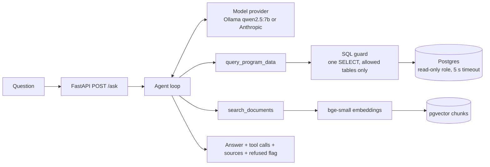

# program-data-assistant

An assistant that answers questions about a field program from that program's own data and documents. A field director or organizer asks something like "Which offices will miss their goal, and by how much?" and gets a short answer with the numbers, the SQL rows and document passages behind them, and a plain "I can't confirm that" when the data doesn't cover the question.

It runs on a fictional GOTV canvass, Riverbend Votes, and a fictional voter registration drive, Riverbend Registers, each with three offices (Northside, Eastgate, Harbor). All names, places and numbers are made up by a seeded generator.

## Why

Program staff spend a lot of time pulling the same numbers by hand: pace to goal, shifts needed, QC flags, overtime, the weekly client report. Most of it is a SQL query plus a rule from a program document. A model can do that work if it is limited to read-only queries, has to show its sources, and is measured on whether its numbers match the data.

## How it works



- **Data**: Postgres tables for offices, canvassers, shifts, knocks, goals, QC flags, the client's daily report, pay rates, candidate office sites, registration cards and QC calls. Metric views (`v_office_pace`, `v_vr_pace`, `v_contact_rates`, `v_weekly_report` and others) hold the program's definitions so the model doesn't have to rebuild them in SQL.
- **Documents**: six short markdown files (`corpus/`) on how doors are counted, QC rules, the program plan, payroll rules, client reporting and the registration drive. Each is split on its headings, embedded with `BAAI/bge-small-en-v1.5` (local, via fastembed) and stored in pgvector.
- **Tools**: `query_program_data(sql)` and `search_documents(query)`. SQL goes through a guard (sqlglot parse: exactly one SELECT, only program tables and views, no writes, locks or system functions) and then runs as a Postgres role that is read-only with a statement timeout. Results are capped at 200 rows. When a query names a column that doesn't exist, the tool returns the table's real columns so the model can fix it.
- **Answers** cite `[table:...]` and `[doc:...]`. The API returns the tool calls, the rows and passages used, and a `refused` flag.
- **Models**: a provider interface with two implementations. The default is a local open model through Ollama (`qwen2.5:7b`), which is what every result below comes from. The Anthropic provider is written but was not run here (no key on the build machine).

## Run it

Needs Python 3.12 and [uv](https://docs.astral.sh/uv/). No Docker or root: the `pgserver` package starts a local Postgres with pgvector under `.pgdata/`.

```bash
uv sync
uv run pda-generate          # optional: rebuilds data/csv from the seed (same files)
uv run pda-load              # schema, data and document embeddings

# local model
ollama pull qwen2.5:7b && ollama serve
uv run pda-ask "Which offices will miss their goal, and by how much?"
uv run uvicorn program_data_assistant.api:app
curl -s localhost:8000/ask -H 'content-type: application/json' -d '{"question": "Who is over 40 hours this week?"}'
```

With Docker instead of pgserver, `docker compose up -d` starts Postgres with pgvector; set `PDA_DATABASE_URL` and `PDA_READER_URL` as shown in `docker-compose.yml`. That path wasn't tested on the build machine.

Anthropic instead of Ollama: `uv sync --extra anthropic`, set `ANTHROPIC_API_KEY`, and pass `--provider anthropic` (or `PDA_PROVIDER=anthropic`). Untested here.

Settings: `PDA_OLLAMA_MODEL`, `OLLAMA_HOST`, `PDA_OLLAMA_THREADS`, `PDA_ANTHROPIC_MODEL`, `PDA_PGDATA`.

## Evals

`evals/cases.yaml` has 28 cases: the 19 demo questions, three paraphrases, three questions only the documents can answer, and three the assistant should refuse (turnout, a staff member's phone number, a past cycle). Each case lists the tools it needs, the passages a retriever should find, and the facts the answer has to contain. Numeric facts are SQL against the raw tables, written separately from the views, so ground truth never comes from the model or from the views it reads.

`uv run evals --label <name>` runs every case against the model and writes `evals/reports/<name>.json` and `.md`. Metrics:

| metric | what it checks |
| --- | --- |
| tool_choice | the assistant called every tool the case needs |
| retrieval | recall@4 of the expected passages when the retriever gets the question directly |
| facts | share of expected facts in the answer; numbers must be within the case's tolerance of the SQL ground truth |
| citation | at least one citation, and every cited table or passage was actually returned by a tool in that run |
| refusal | refused exactly when it should |
| pass | every metric that applies to the case (retrieval aside) is a full score |

`uv run evals --rescore evals/reports/<name>.json` re-scores saved answers with the current cases without calling the model.

## Results

RESULTS_PLACEHOLDER

## Tests

`uv run pytest` covers the SQL guard (allowed and rejected statements), the read-only role and timeout, retrieval, the scorers, the data stories the questions depend on, and the API through FastAPI's TestClient with a scripted model in place of a real one.

## Limits

- The data is synthetic and built so each question has a clear answer. Real program data is messier: late clock-outs, turf changes, reassigned canvassers.
- A 7B model on CPU is slow (about a minute per question here) and still makes mistakes the evals catch; see the per-case reports.
- The metric views do much of the work. That is a deliberate choice (definitions live in SQL, where they can be tested), but it means new kinds of questions need new views or the model has to write harder SQL.
- Fact checks look for numbers and names in the answer text. They can't tell a right number used to reach a wrong conclusion, so the per-case answers are worth reading alongside the scores.
- Refusal detection looks for the fixed refusal sentence the prompt asks for.
