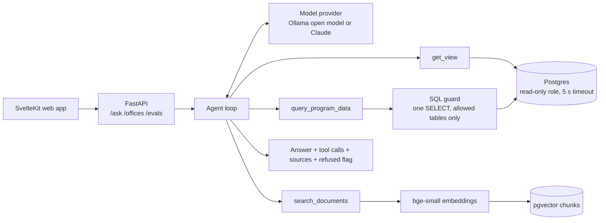

# program-data-assistant

An assistant that answers questions about a field program from that program's own data and documents. A field director or organizer asks something like "Which offices will miss their goal, and by how much?" and gets a short answer with the numbers, the SQL rows and document passages behind them, and a plain "I can't confirm that" when the data doesn't cover the question.

It runs on a fictional GOTV canvass, Riverbend Votes, and a fictional voter registration drive, Riverbend Registers, each with three offices (Northside, Eastgate, Harbor). All names, places and numbers are made up by a seeded generator.

What's in this repository:

- **Web app**: SvelteKit and TypeScript (`web/`), a chat that shows the sources behind each number, office tabs, and a page on how it's tested.
- **Backend**: Python and FastAPI, with read-only tools over Postgres and pgvector document search.
- **Model**: a self-hosted open model through Ollama (qwen3.8:27b in the results below), with Claude on the Anthropic API or Vertex AI as a configuration switch.
- **Infrastructure**: Terraform for Google Cloud in `infra/` (Cloud Run, Cloud SQL Postgres with pgvector, Secret Manager, Artifact Registry, per-service accounts) and Dockerfiles. Checked with `terraform validate` and a plan against a placeholder project; never applied, so nothing is deployed.
- **Evals**: 28 test questions scored against SQL ground truth, half of them held out from tuning.

## Why

Program staff spend a lot of time pulling the same numbers by hand: pace to goal, shifts needed, QC flags, overtime, the weekly client report. Most of it is a SQL query plus a rule from a program document. A model can do that work if it is limited to read-only queries, has to show its sources, and is measured on whether its numbers match the data.

## How it works



- **Data**: Postgres tables for offices, canvassers, shifts, knocks, goals, QC flags, the client's daily report, pay rates, candidate office sites, registration cards and QC calls. Metric views (`v_office_pace`, `v_vr_pace`, `v_contact_rates`, `v_weekly_report` and others) hold the program's definitions so the model doesn't have to rebuild them in SQL.
- **Documents**: six short markdown files (`corpus/`) on how doors are counted, QC rules, the program plan, payroll rules, client reporting and the registration drive. Each is split on its headings, embedded with `BAAI/bge-small-en-v1.5` (local, via fastembed) and stored in pgvector.
- **Tools**: `get_view(view, office, week_start)` returns a metric view, `query_program_data(sql)` runs read-only SQL, `search_documents(query)` searches the documents. SQL goes through a guard (sqlglot parse: exactly one SELECT, only program tables and views, no writes, locks or system functions) and then runs as a Postgres role that is read-only with a statement timeout. Results are capped at 200 rows. When a query names a column that doesn't exist, the tool returns the table's real columns so the model can fix it.
- **Answers** cite `[table:...]` and `[doc:...]`. The API returns the tool calls, the rows and passages used, and a `refused` flag.
- **Models**: a provider interface with two implementations, picked with `PDA_PROVIDER`. The default is a self-hosted open model through Ollama, which is what every result below comes from. `PDA_PROVIDER=anthropic` uses Claude through the Anthropic API instead. That path is covered by tests with a mocked client, but it hasn't been run against the real API. Every answer reports which model produced it.
- **Web app** (`web/`): SvelteKit and TypeScript. It shows the answer with citation chips that open the rows or passage behind each number, the tools called, office tabs, and a page on how it's tested. Built as static files; it also runs with no backend in demo mode, from the recorded runs. See `web/README.md`.
- **API** (`docs/api.md`): `POST /ask`, `GET /offices` (office summaries straight from the views), `GET /evals` and `GET /recorded` (the eval scoreboard and recorded runs), `GET /health`.

## Run it

Needs Python 3.12 and [uv](https://docs.astral.sh/uv/). No Docker or root: the `pgserver` package starts a local Postgres with pgvector under `.pgdata/`.

```bash
uv sync
uv run pda-generate          # optional: rebuilds data/csv from the seed (same files)
uv run pda-load              # schema, data and document embeddings

# local model
ollama pull qwen2.5:7b && ollama serve
uv run pda-ask "Which offices will miss their goal, and by how much?"
uv run uvicorn program_data_assistant.api:app
curl -s localhost:8000/ask -H 'content-type: application/json' -d '{"question": "Who is over 40 hours this week?"}'
```

The web app, against that API:

```bash
PDA_CORS_ORIGINS=http://localhost:5173 uv run uvicorn program_data_assistant.api:app --port 8000
cd web && npm install && PUBLIC_API_URL=http://localhost:8000 npm run dev
```

Leave out `PUBLIC_API_URL` and the web app runs in demo mode from the recorded runs, with no API or model.

With Docker instead of pgserver, `docker compose up -d` starts Postgres with pgvector; set `PDA_DATABASE_URL` and `PDA_READER_URL` as shown in `docker-compose.yml`. That path wasn't tested on the build machine.

Claude instead of an open model: `uv sync --extra anthropic`, set `ANTHROPIC_API_KEY` and `PDA_PROVIDER=anthropic` (optionally `PDA_ANTHROPIC_MODEL`). The eval runner takes the same switch: `uv run evals --provider anthropic --label claude`. Not run against the real API here.

Claude on Google Vertex AI: `uv sync --extra vertex`, `PDA_PROVIDER=vertex`, and set `PDA_VERTEX_PROJECT`, `PDA_VERTEX_REGION` and `PDA_VERTEX_MODEL` (the model ID as Vertex names it). It signs in with the machine's Google identity, so there is no key; on Cloud Run that is the API's service account (see `infra/`). Untested against Vertex here.

Settings:
- Model: `PDA_PROVIDER` (`ollama`, `anthropic` or `vertex`), `PDA_OLLAMA_MODEL`, `OLLAMA_HOST`, `PDA_OLLAMA_CTX`, `PDA_OLLAMA_THREADS`, `PDA_OLLAMA_THINK`, `PDA_ANTHROPIC_MODEL`, `ANTHROPIC_API_KEY`, `PDA_VERTEX_PROJECT`, `PDA_VERTEX_REGION`, `PDA_VERTEX_MODEL`.
- Database: `PDA_DATABASE_URL`, `PDA_READER_URL`, `PDA_PGDATA`.
- API: `PDA_CORS_ORIGINS`.

## Repository layout

| path | what's there |
| --- | --- |
| `src/program_data_assistant/` | FastAPI app (`api.py`), agent loop, tools, SQL guard, retrieval, model providers, eval runner, data generator and loader |
| `src/program_data_assistant/sql/schema.sql` | tables, metric views, the read-only role |
| `data/csv/`, `corpus/` | the fictional program data and its six documents |
| `evals/` | `cases.yaml` (28 cases with a dev/held-out split) and every report |
| `demo/` | recorded runs the web app's demo mode uses |
| `web/` | SvelteKit and TypeScript front end |
| `docs/api.md` | the API contract |
| `tests/` | pytest suite, through FastAPI's TestClient and the eval runner |
| `Dockerfile`, `web/Dockerfile` | API image (also runs the load job) and web image |
| `infra/` | Terraform for Google Cloud |

## Deployment

`infra/` has Terraform for Google Cloud: the API and the web app on Cloud Run, Postgres 16 with pgvector on Cloud SQL, database URLs in Secret Manager, images in Artifact Registry, one service account per workload, and a Cloud Run job that runs `pda-load`. The model is the self-hosted Ollama server over a private network, Claude on Vertex AI, or Claude through the Anthropic API. `infra/README.md` has the deploy order, rough costs (about $10 to $15 a month, mostly the database) and what was checked.

Nothing has been deployed. The Terraform passes `validate`, `tflint` and `checkov` and plans against a made-up project; the Docker images have not been built, because the build machine has no Docker.

## Evals

`evals/cases.yaml` has 28 cases: the 19 demo questions, three paraphrases, three questions only the documents can answer, and three the assistant should refuse (turnout, a staff member's phone number, a past cycle). Each case lists the tools it needs, the passages a retriever should find, and the facts the answer has to contain. Numeric facts are SQL against the raw tables, written separately from the views, so ground truth never comes from the model or from the views it reads.

`uv run evals --label <name>` runs every case against the model and writes `evals/reports/<name>.json` and `.md`. Metrics:

| metric | what it checks |
| --- | --- |
| tool_choice | the assistant called every tool the case needs |
| retrieval | recall@4 of the expected passages when the retriever gets the question directly |
| facts | share of expected facts in the answer; numbers must be within the case's tolerance of the SQL ground truth |
| citation | at least one citation, and every cited table or passage was actually returned by a tool in that run |
| refusal | refused exactly when it should |
| pass | every metric that applies to the case (retrieval aside) is a full score |

`uv run evals --rescore evals/reports/<name>.json` re-scores saved answers with the current cases without calling the model.

## Results

All runs use the same 28 cases and the same scorer, at temperature 0. The CPU runs are on the 8-core server (shared, no GPU); the GPU runs go to Ollama on an RTX 3080 laptop GPU (16 GB) over an SSH tunnel. Per-case tables for every run are in `evals/reports/`.

| run | model | hardware | code | tool choice | retrieval | facts | citation | refusal | pass | s per answer |
| --- | --- | --- | --- | --- | --- | --- | --- | --- | --- | --- |
| target | | | | 90%+ | 95%+ | 80%+ | 90%+ | 90%+ | 20 of 28+ | under 15 |
| baseline | qwen2.5:7b | server CPU | baseline prompt, free SQL | 76% | 98% | 26% | 40% | 61% | 7 of 28 | 86 |
| improved | qwen2.5:7b | server CPU | views, get_view, guardrails | 76% | 98% | 48% | 60% | 86% | 8 of 28 | 124 |
| improved-gpu-7b-a | qwen2.5:7b | RTX 3080 laptop | + 'All offices' fix | 76% | 98% | 61% | 56% | 89% | 11 of 28 | 4 |
| improved-gpu-7b-b | qwen2.5:7b | RTX 3080 laptop | + citation check | 84% | 98% | 69% | 84% | 96% | 16 of 28 | 7 |
| improved-gpu-7b | qwen2.5:7b | RTX 3080 laptop | + look-first nudge (final code) | 84% | 98% | 72% | 84% | 93% | 16 of 28 | 8 |
| improved-gpu-14b | qwen2.5:14b | RTX 3080 laptop | final code | 84% | 98% | 68% | 64% | 96% | 13 of 28 | 57 |
| improved-gpu-qwen35-9b | qwen3.5:9b | RTX 3080 laptop | final code, thinking off | 88% | 98% | 73% | 88% | 93% | 19 of 28 | 9 |
| improved-gpu-qwen38-27b | qwen3.8:27b | RTX 3080 laptop, part on CPU | final code, thinking off | 96% | 98% | 93% | 100% | 100% | 25 of 28 | 52 |

Where the best run (qwen3.8:27b) lands against the targets: tool choice 96%, retrieval 98%, facts 93%, citation 100%, refusal 100%, and 25 of 28 passing all meet them. Speed doesn't: 52 s per answer, because the 27B model doesn't fit in 16 GB of VRAM and part of it runs on the CPU. The fastest run that comes close is qwen3.5:9b at 9 s per answer and 19 of 28 passing, with facts at 73%. The qwen2.5 runs miss the facts and pass targets.

The cases qwen3.8:27b still gets wrong:

- q04 (regulars among active canvassers) counts registration canvassers too: 66, where the program plan's definition covers GOTV canvassers only (49 of 57).
- q07 (the Oct 12 client report gap) explains the attempts and the rollback with correct per-office numbers, but never gives the program totals (1,484 reported against 1,281 on the dashboard).
- q12 (shifts that need a conversation today) is right: it lists all four open flags with their evidence. It writes the count as "Four", and the number scorer only reads digits, so it's marked as a miss.

What changed between the baseline and the final code:

- Helper views for common questions (contact rate, cost per door, weekly client report, staff status, QC flags with names, shifts to fix, registration results, QC call outcomes) and a `get_view` tool that returns a whole view, so the model reads values instead of writing SQL. `office: 'All offices'` means no filter, and a week filter is ignored on views without a week column.
- A schema guide with column meanings, an answer template (answer first, then numbers with citations), and three short examples that are not eval questions.
- Guardrails:
  - Real column names are sent back on SQL errors, with one retry.
  - A 0-row result gets a note, and repeating the same query is blocked.
  - A model that answers without calling any tool is told to look first.
  - An answer whose citations aren't among the sources actually returned gets the list of valid ids and one rewrite.
  - An answer with numbers that appear in no tool result gets one rewrite; if they're still unsupported, it's withheld as "I can't confirm".
- For qwen3.x, Ollama's `think` flag is set to false, and any leaked `<think>` block is stripped from the answer.

Two earlier attempts at the improved code were stopped after a few cases because the model still made up numbers after empty results. A qwen2.5:14b attempt was also stopped: it answered without calling tools, and the grounding check withheld those answers. None of these are reported as runs. The demo (`demo/recorded_runs.json`) uses the qwen3.8:27b run, with the CPU baseline shown alongside.

### Tuning with a held-out split

After the runs above, the 28 cases were split into 14 dev and 14 held-out test cases (refusal cases on both sides; `split` in `cases.yaml`). Changes were tried on dev only, on qwen3.5:9b, one at a time:

| step | dev pass | dev facts | dev citation | s per answer |
| --- | --- | --- | --- | --- |
| starting point (improved-gpu-qwen35-9b) | 10 of 14 | 75% | 92% | 8 |
| grounding prompt: answer only from tool results, copy figures exactly, permission to decline | 10 of 14 | 75% | 92% | 7 |
| tool descriptions (answers, doesn't answer, example, get_view before SQL), routing policy, week filter on the flags view | 11 of 14 | 87% | 100% | 5 |
| structured citations: {text, source} lines with an enum of returned ids, rendered by code | 9 of 14 | 87% | 67% | 9 |
| same, plus code-assigned sources for lines whose figures match a result | 10 of 14 | 87% | 83% | 9 |
| business glossary (grain, date windows, denominators), structured citations off | 10 of 14 | 87% | 83% | 6 |
| drop citations to ids no tool returned | 11 of 14 | 87% | 100% | 6 |

Structured citations scored below typed citations plus the citation check on dev, so they are off by default (`PDA_STRUCTURED_CITATIONS=1` turns them on). The glossary made the model cite document ids that don't exist, and the last step removes those. Constrained JSON routing and per-model sampling settings were not tried.

Final comparison, all 28 cases run 3 times each at temperature 0 (`final-qwen35-9b-x3`):

| split | tool choice | retrieval | facts | citation | refusal | pass | pass^3 | s per answer |
| --- | --- | --- | --- | --- | --- | --- | --- | --- |
| dev | 83% | 96% | 87% | 100% | 100% | 11 of 14 | 11 of 14 | 6 |
| test (held out) | 92% | 100% | 78% | 100% | 100% | 10 of 14 | 10 of 14 | 10 |
| all 28 | 88% | 98% | 82% | 100% | 100% | 21 of 28 | 21 of 28 | 8 |

The same final code on qwen3.8:27b, 3 runs per case with a 16,384-token context (`final-qwen38-27b-dev-x3`, `final-qwen38-27b-test-x3`):

| split | tool choice | retrieval | facts | citation | refusal | pass | pass^3 | s per answer |
| --- | --- | --- | --- | --- | --- | --- | --- | --- |
| dev | 100% | 96% | 96% | 100% | 100% | 13 of 14 | 13 of 14 | 57 |
| test (held out) | 92% | 100% | 87% | 100% | 100% | 11 of 14 | 11 of 14 | 59 |

On the held-out half, 27B is one case ahead of 9B (11 against 10) and nine points higher on facts, at about six times the time per answer. The larger context is needed because a long second turn overflowed 8,192 tokens; Ollama then dropped the question from the conversation and the request failed.

Against the targets, qwen3.5:9b now meets retrieval, facts, citation, refusal, pass (21 of 28) and speed (8 s). It misses tool choice (88% against 90%). The held-out test facts score (78%) is below the dev score (87%), which is the gap the split is there to show. At temperature 0 the three runs rarely differ, so pass^3 equals pass here. Cases still failing: q04 (counts registration canvassers too), q05 (more doors vs second pass numbers), q07 (Oct 12 totals), q08 (dense untouched doors total), q11 (one name missed), q12 (counts written as words), q16 (Harbor duplicates total).

## Tests

`uv run pytest` covers:
- the SQL guard (allowed and rejected statements), the read-only role and the timeout;
- retrieval, the scorers, and the data stories the questions depend on;
- the API (`/ask`, `/offices`, `/evals`, `/recorded`, CORS) through FastAPI's TestClient, with a scripted model in place of a real one;
- the Claude backend through the same API and the eval runner, with a fake Messages client, so no key and no paid calls.

In `web/`, `npm test` (vitest) covers the question matcher, citation-to-source mapping and the markdown subset (markup in an answer stays text), and `npm run check` runs svelte-check.

## Limits

- The data is synthetic and built so each question has a clear answer. Real program data is messier: late clock-outs, turf changes, reassigned canvassers.
- A 7B model on CPU is slow (one to two minutes per question here, sometimes ten) and still makes mistakes the evals catch; see the per-case reports. A larger hosted model through the Anthropic provider is the obvious next comparison but was not run.
- The metric views do much of the work. That is a deliberate choice (definitions live in SQL, where they can be tested), but it means new kinds of questions need new views or the model has to write harder SQL.
- Fact checks look for numbers and names in the answer text. They can't tell a right number used to reach a wrong conclusion, so the per-case answers are worth reading alongside the scores.
- Refusal detection looks for the fixed refusal sentence the prompt asks for.
