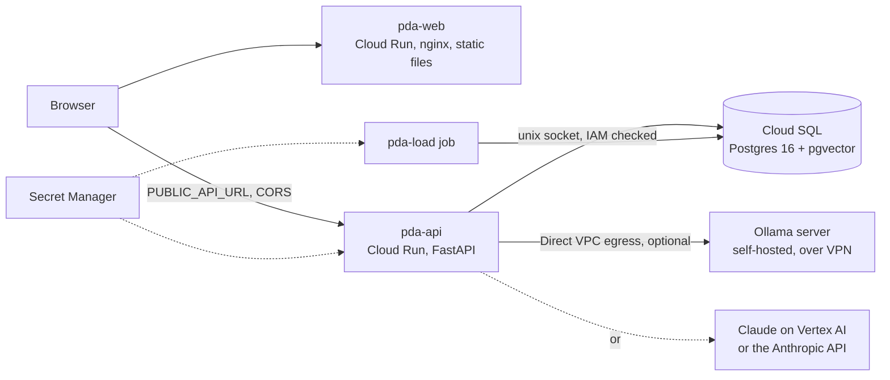

# Deploying to Google Cloud

Terraform for running the program data assistant on GCP: the FastAPI backend and the SvelteKit web app on Cloud Run, Postgres 16 with pgvector on Cloud SQL, images in Artifact Registry and database URLs in Secret Manager. The model is either a self-hosted Ollama server reached over a private network, Claude through the Anthropic API, or Claude on Vertex AI.

None of this has been applied to a real project. See [What was tested](#what-was-tested) for exactly what was checked.

## Layout

| file | what it sets up |
| --- | --- |
| `versions.tf` | Terraform and Google provider versions, and a commented GCS backend block |
| `variables.tf` | every input, with defaults |
| `apis.tf` | the Google APIs the project needs (Run, Cloud SQL Admin, Artifact Registry, Secret Manager, IAM; Compute with a VPC; Vertex AI with `model_provider = "vertex"`) |
| `registry.tf` | a Docker repository with a cleanup policy (ten most recent versions kept, untagged layers deleted after two weeks) |
| `database.tf` | the Cloud SQL Postgres 16 instance and the `pda` database |
| `secrets.tf` | Secret Manager secrets for the two database URLs and, with the Anthropic provider, the API key. Containers only, no values |
| `iam.tf` | three service accounts and their roles |
| `run.tf` | Cloud Run services `pda-api` and `pda-web`, the `pda-load` job, public access |
| `outputs.tf` | registry path, Cloud SQL connection name, URL templates, service URLs |
| `terraform.tfvars.example` | sample inputs for a made-up project |

The Dockerfiles are `../Dockerfile` (API, also used by the load job) and `../web/Dockerfile` (web app).

## How the pieces fit



**Database connection.** Cloud Run mounts the Cloud SQL connection (the Auth Proxy) as a unix socket under `/cloudsql`. The instance has a public IP with no authorized networks and requires client certificates, so the only way in is through that connection, which checks that the caller's service account has `roles/cloudsql.client`. This was picked over private IP because it needs no VPC, private services access or peering just for the database. If the project already has a VPC for the model server, private IP is a reasonable next step.

**pgvector and the read-only role** come from the app, not Terraform. `pda-load` runs the app's `schema.sql` (`CREATE EXTENSION IF NOT EXISTS vector`, the tables and views, the `pda_reader` role) and then sets the reader's password from `PDA_READER_URL`. The SQL tool connects as `pda_reader`, which is read-only with a 5 second statement timeout, the same as locally.

**Passwords** stay out of Terraform state. The `postgres` password is set with `gcloud`, and both database URLs are added to Secret Manager by hand. Terraform only creates the empty secrets and decides who can read them.

**Service accounts**

| account | roles |
| --- | --- |
| `pda-api` | `cloudsql.client`; `secretAccessor` on the reader URL secret (and the Anthropic key secret with that provider); `aiplatform.user` with the Vertex provider |
| `pda-loader` | `cloudsql.client`; `secretAccessor` on the admin URL and reader URL secrets |
| `pda-web` | none (it serves static files) |

`cloudsql.client` can only be granted on the whole project. That's fine when the project holds only this app; in a shared project, add an IAM condition on the instance name.

**The model.** `model_provider` picks one of:

- `ollama` (default): `ollama_host` is the self-hosted server's URL, for example `http://10.20.0.5:11434` on a VPN into the VPC named by `vpc_network` and `vpc_subnetwork`. With those set, the API sends private-range traffic through Direct VPC egress. Ollama has no authentication, so don't put it on the public internet.
- `vertex`: Claude on Vertex AI, signed in as `pda-api` itself. No key. Set `vertex_region` and `vertex_model` (the model ID as Vertex names it) and enable the model in the project's Model Garden first.
- `anthropic`: Claude through the Anthropic API, with the key in the `pda-anthropic-api-key` secret.

**The two URLs.** The web app needs the API's address at build time (`PUBLIC_API_URL`), and the API needs the web app's address for CORS (`PDA_CORS_ORIGINS`). Terraform handles the second: the API service reads the web service's URLs, and the web service doesn't reference the API, so there's no cycle. For the first, Cloud Run gives each service a fixed address, `https://<service>-<project number>.<region>.run.app`, so the web image can be built before the API exists. A custom domain goes in `extra_cors_origins`.

## Deploying

Needs `gcloud`, Terraform 1.9 or later, Docker, and a project with billing on. The person running it needs to be able to create the resources above (Owner on a fresh demo project is the simple case).

**1. Base resources** (APIs, registry, database, secrets, service accounts):

```bash
cd infra
cp terraform.tfvars.example terraform.tfvars   # set project_id, keep deploy_services = false
terraform init
terraform apply                                # the Cloud SQL instance takes about 10 minutes
```

**2. Passwords and secret values.** Hex passwords need no escaping inside a URL.

```bash
PROJECT=riverbend-demo-123456 REGION=us-central1
CONN=$(terraform output -raw db_connection_name)
ADMIN_PW=$(openssl rand -hex 24) READER_PW=$(openssl rand -hex 24)

gcloud sql users set-password postgres --instance=pda-db --password="$ADMIN_PW"
printf 'postgresql://postgres:%s@/pda?host=/cloudsql/%s' "$ADMIN_PW" "$CONN" \
  | gcloud secrets versions add pda-db-admin-url --data-file=-
printf 'postgresql://pda_reader:%s@/pda?host=/cloudsql/%s' "$READER_PW" "$CONN" \
  | gcloud secrets versions add pda-db-reader-url --data-file=-
unset ADMIN_PW READER_PW

# Only with model_provider = "anthropic":
# gcloud secrets versions add pda-anthropic-api-key --data-file=-   (paste the key, then Ctrl-D)
```

**3. Build and push the images.**

```bash
REG=$(terraform output -raw registry)
TAG=$(git rev-parse --short HEAD)
NUMBER=$(gcloud projects describe "$PROJECT" --format='value(projectNumber)')
gcloud auth configure-docker "$REGION-docker.pkg.dev"

docker build --platform linux/amd64 -t "$REG/api:$TAG" ..
docker build --platform linux/amd64 -t "$REG/web:$TAG" \
  --build-arg PUBLIC_API_URL="https://pda-api-$NUMBER.$REGION.run.app" ../web
docker push "$REG/api:$TAG" && docker push "$REG/web:$TAG"
```

**4. Services.** In `terraform.tfvars` set `deploy_services = true`, `api_image_tag` and `web_image_tag` to `$TAG`, and the model inputs, then `terraform apply`.

**5. Load the schema, data and documents** (again whenever they change; it drops and recreates the `program` and `docs` schemas):

```bash
gcloud run jobs execute pda-load --region "$REGION" --wait
curl -s "$(terraform output -raw api_url)/health"   # {"status": "ok", "database": "ok", ...}
```

Then open `terraform output -raw web_url`.

Later releases: build and push with a new tag, change the two tags, `terraform apply`. Run the load job only if the data or schema changed.

## Costs

Rough monthly estimates at us-central1 list prices, for a demo with light traffic. They are estimates, not quotes; check the [pricing calculator](https://cloud.google.com/products/calculator) for your region.

| item | estimate | notes |
| --- | --- | --- |
| Cloud SQL, `db-f1-micro`, 10 GB SSD, 7 backups | about $10 to $15 | runs all the time, so it's most of the bill. Shared core, no SLA. A dedicated core (`db-custom-1-3840`) is roughly $50 |
| Cloud Run, API and web | about $0 | both scale to zero and only bill CPU during requests. Light demo traffic fits in the monthly free tier |
| Artifact Registry | under $1 | first 0.5 GB free, then $0.10 per GB per month. The API image is likely 1.5 to 2 GB (Python packages, onnxruntime, the embedding model; not measured) |
| Secret Manager | a few cents | |
| Cloud VPN to the model server | about $35 or more | only if you use one; billed per tunnel hour |
| The model | varies | Ollama runs on your own hardware. Claude through Vertex or the Anthropic API is billed per token |

So about $10 to $15 a month without a VPN. `terraform destroy` removes it all once `db_deletion_protection` is set to false and applied.

The API is public with no sign-in, so anyone with the URL can ask questions. With a Claude provider, each question costs tokens; `api_max_instances` caps how many run at once, not how many arrive.

## What was tested

On the build machine (no Docker, no GCP credentials):

- `terraform fmt -check`, `terraform init -backend=false` and `terraform validate`: pass, with Terraform 1.17.2 and Google provider 7.46.2.
- `terraform plan` against the made-up project in `terraform.tfvars.example`, with a fake access token (`GOOGLE_OAUTH_ACCESS_TOKEN=dummy`) and `-refresh=false`, so no call to Google succeeds. 18 resources with `deploy_services = false`; 24 with the services and the Ollama provider; 25 with Vertex or Anthropic. Leaving `ollama_host` empty with the Ollama provider stops the plan with a clear error, as intended.
- `tflint` with the Google ruleset: no findings.
- `checkov`: 26 passed, 0 failed, 8 skipped. Each skip has its reason next to the resource (public IP through the connector, Postgres 16, Google-managed encryption, statement and audit logging left off for made-up data).
- `hadolint` on both Dockerfiles: no findings.
- `uv run pytest`, including the reader password step of `pda-load` and the Vertex provider's configuration (no request sent).

Not tested:

- The Docker images were never built: Docker isn't available on the build machine. The Dockerfiles are linted only, and the nginx config was not run.
- `terraform apply` was never run, so nothing here has met real GCP: API enablement timing, the Cloud SQL instance, `CREATE EXTENSION vector` as the `postgres` user, the socket URLs with psycopg, Secret Manager mounts, the load job and the public access bindings.
- No calls to Vertex AI, and no Ollama server over a VPN.
- Organization policies. A policy that blocks `allUsers` (domain restricted sharing) stops the public access step; the services still deploy.
